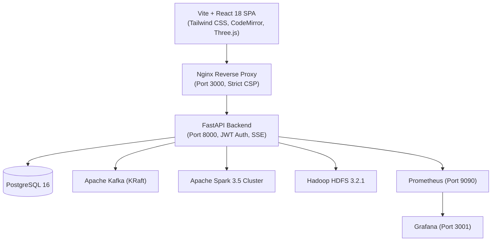

# ChaosFlow: Configuration-Driven Resilient Big Data Pipeline Platform with Built-in Chaos Testing


ChaosFlow is an enterprise-grade platform for authoring, running, observing, and stress-testing big data pipelines under real-world infrastructure failures. It combines declarative YAML pipeline orchestration, interactive cluster topology visualization, and an automated chaos engineering engine (**ChaosLab**) to validate pipeline resilience, calculate recovery times (MTTR), and assess data loss.

---

## Architecture



---

## Quickstart

Get the full 13-container stack running in three commands:

```powershell
# 1. Generate secrets and environment config (.env)
# Windows PowerShell:
.\scripts\setup-env.ps1

# Linux / macOS / Bash:
# cp .env.example .env, then generate strong passwords for POSTGRES_PASSWORD,
# JWT_SECRET_KEY, GRAFANA_ADMIN_PASSWORD, and ADMIN_PASSWORD.
# (Note: Pydantic strictly validates that placeholder passwords like 'change-me-before-running' are replaced)

# 2. Build and launch all container services
docker compose up -d --build

# 3. Open the UI in your browser
Start-Process "http://localhost:3000"
```

> **Note on Authentication**: The application presents a login screen on first load. The initial credentials (`ADMIN_USERNAME` and `ADMIN_PASSWORD`) are generated by `setup-env.ps1` and stored securely in `.env`.

---

## Pipeline Configuration & Ingestion Options

Pipelines are declared using declarative YAML definitions. 

### Batch and Streaming Ingestion
- **Standard Batch Source**: Reads directly from storage paths (CSV, JSON, Parquet) into Apache Spark batch jobs.
- **`batch_kafka_ingestion`**: Configurable boolean flag on pipelines. When enabled for high-throughput batch workloads, the platform streams batches into an ephemeral Kafka topic before ingestion, enabling real-time Kafka buffer stress testing during fault scenarios.
- **Streaming Ingestion**: Continuous ingestion from Apache Kafka with watermarking, checkpointing, and structured streaming micro-batches.

### Sample Pipelines
ChaosFlow ships with pre-configured declarative pipeline definitions:

| Template Name | Source Format | Engine | Destination | Streaming | Key Features |
|---|---|---|---|---|---|
| `sales-csv` | CSV (`sales_sample.csv`) | Spark (Batch) | HDFS Parquet | `false` | Null removal, deduplication, amount filtering |
| `sales-streaming` | CSV / Kafka stream | Spark Structured Streaming | HDFS Parquet | `true` | Micro-batch trigger, consumer lag tracking, watermark |
| `sales-large` | CSV (1M rows) | Spark (Batch) | HDFS Parquet | `false` | Large scale batch processing with fault recovery |
| `iot-json` | JSON (`sensor_readings.json`) | Spark (Batch) | HDFS Parquet | `false` | Semi-structured schema inference and threshold filtering |

---

## Chaos Engineering (ChaosLab)

ChaosLab enables controlled, safety-validated fault injection against live cluster infrastructure:

| Fault Type | Target Service | Blast Radius | Auto-Recovery Mechanism |
|---|---|---|---|
| `container_stop` | `kafka`, `spark-worker`, `datanode` | Single container halted | Automated container start after configured duration |
| `container_restart` | `kafka`, `spark-worker`, `datanode` | Transient outage | Container restarted via Docker daemon API |
| `network_latency` | `kafka`, `spark-worker`, `datanode` | Injected network delay | Traffic control (tc/netem) rules cleared on revert |
| `network_packet_loss`| `kafka`, `spark-worker`, `datanode` | Dropped packet ratio | Traffic control (tc/netem) impairment removed |
| `cpu_burn` | `kafka`, `spark-worker`, `datanode` | CPU core saturation | Stress-ng process terminated on revert |
| `memory_stress` | `kafka`, `spark-worker`, `datanode` | Memory pressure | Stress-ng worker killed and memory reclaimed |

### Safety Rules & Platform Concurrency
- **Platform-Wide Concurrency Lock**: Only **one** experiment run can be active platform-wide at any given moment. Starting any second experiment while one is pending or running (regardless of target service) is strictly rejected with HTTP `409 Conflict`.
- **Database Partial Unique Index**: Concurrency is enforced at the database level by a partial unique index on active states (`uq_experiment_runs_active_target`), preventing race conditions.
- **Forbidden Targets**: Core platform services (`postgres`, `backend`, `frontend`, `namenode`) cannot be targeted for fault injection.
- **Maximum Duration**: Experiment durations are capped by `SAFETY_MAX_FAULT_DURATION_SECONDS` (default: 300s).

### Multi-Repetition Experiments & In-Flight Ingestion
- **Repetitions (1–10)**: Experiments support executing 1 to 10 repetitions to compute rigorous statistical confidence intervals (mean, std, min, max).
- **Repetition Pipeline Execution**: For experiments linked to a pipeline with `repetitions > 1`, **each repetition launches its own fresh pipeline run**, injecting the fault while that specific pipeline run is actively in-flight.
- **`baseline_seconds` Configuration**: Configurable baseline measurement window duration (default: 3.0s, bounded [1, 60] seconds) over which pre-fault availability and throughput are established.
- **`pre_fault_accounting`**: Every repetition captures a pre-fault accounting snapshot containing its unique `pipeline_run_id`, active counter snapshots, and pre-fault record counts.

---

## Resilience Metrics & Normal vs During-Fault Comparison

Resilience reports feature a side-by-side **Comparison Table** comparing baseline (normal) operation against active fault conditions:

| Metric | Normal (Baseline) | During Fault | Delta / Pct Change | Provenance & Rules |
|---|---|---|---|---|
| **Availability** | Mean % operational | % operational during fault | Delta & % Change | Probed at 1.0s intervals with 5s timeout on hung probes. |
| **Throughput** | Measured rate (records/sec) | Measured rate (records/sec) | Delta & % Change | Uses `spark.recordsOut` or `kafka.published`. Set to `null` with `"pipeline not active at injection"` if pipeline was not progressing. |
| **Recovery Time (MTTR)**| `null` ("n/a (by definition)") | Measured elapsed seconds | `null` | No fault-free baseline counterpart exists by definition. |
| **Data Loss** | `null` ("n/a (by definition)") | Physical unwritten rows | `null` | Derived independently: $\max(0, \text{Expected} - \text{Actual})$. Expected from driver, actual from post-recovery HDFS scan. |
| **Duplicates** | `null` ("not measured") | Net fault-induced duplicates | `null` | Fault-induced: $\max(0, \text{Output Dups} - \text{Source Dups})$. Source duplicates are excluded so inherent data duplicates do not count against resilience. |

> Detailed formulas, counters, window definitions, and edge conditions are fully documented in [`docs/metrics-definitions.md`](docs/metrics-definitions.md).

### Known Measurement Limitations
- **`container_restart` Availability Limitation**: Under `container_restart`, the Docker daemon restart call blocks synchronously until the target container is operational. Availability probes dispatched immediately upon return will observe 100% availability during the subsequent fault window.

---

## Verification & Tests

### Dataset Generation (Prerequisites for Large/Reliability Tests)

ChaosFlow includes deterministic data generators for large-scale and reliability testing:
```powershell
# Generate 1M-row dataset for integration & streaming tests
python scripts/generate_sales_data.py --rows 1000000 --out backend/sample-data/sales_large.csv

# Generate 300k-row dataset for fault injection evidence & multi-repetition tests
# (produces exactly 300,000 rows, 4,932 duplicate extra rows, 4,842 duplicated IDs)
python scripts/generate_sales_data.py --rows 300000 --seed 42 --out backend/sample-data/sales_300k.csv

# Generate all 4 large dataset evaluation shapes (clean, with_nulls, with_duplicates, edge_cases):
python scripts/generate_large_dataset.py --shape clean --rows 1000000 --out backend/sample-data/sales_large.csv
python scripts/generate_large_dataset.py --shape with_nulls --rows 1000000 --out backend/sample-data/sales_large_nulls.csv
python scripts/generate_large_dataset.py --shape with_duplicates --rows 1000000 --out backend/sample-data/sales_large_duplicates.csv
python scripts/generate_large_dataset.py --shape edge_cases --rows 1000000 --out backend/sample-data/sales_large_edge.csv

# Run the 1M-row batch pipeline evaluation benchmark across all 4 shapes:
python scripts/run_batch_evaluation.py
```
*(Note: Playwright's global setup automatically runs `generate_sales_data.py` if those test datasets are absent.)*


1. **Static Analysis & Linting**:
   ```bash
   cd frontend
   npm install   # Prerequisite: install frontend dependencies
   npm run lint
   npm run build
   ```

2. **Backend Unit & Integration Tests**:
   ```bash
   docker exec platform-backend pytest -q -m "not integration"
   docker exec platform-backend pytest -q -m integration
   ```

3. **Frontend Vitest Suite**:
   ```bash
   cd frontend
   npm run test -- --run
   ```

4. **End-to-End Playwright Tests (59 Tests)**:
   ```bash
   cd frontend
   npx playwright test --workers=1 --reporter=line
   ```

---

## Verification Evidence

| Verification Gate | Requirement | Clean-Clone Result | Status |
|---|---|---|---|
| Static Analysis | ESLint & TypeCheck | 0 errors, 0 warnings | **PASS** |
| Production Bundle | Client bundle size | 320.06 kB (< 323.06 kB limit) | **PASS** |
| Backend Unit Tests | Pytest unit suite | 589 passed, 16 skipped | **PASS** |
| Backend Integration | Pytest integration suite | 44 passed | **PASS** |
| Frontend Unit Tests | Vitest suite | 25 files, 249 tests passed | **PASS** |
| Full E2E Playwright | Complete test suite | 59 tests passed in 10 files | **PASS** |
| Automated Demo | 9-Stage Chaos Scenario | Result PASS, MTTR < 60s | **PASS** |
| Checkpoint Hygiene | HDFS `/checkpoints` | 0 leftover directories | **PASS** |

---

## License & Authors

Distributed under the MIT License. Developed for resilient distributed data infrastructure research and engineering.