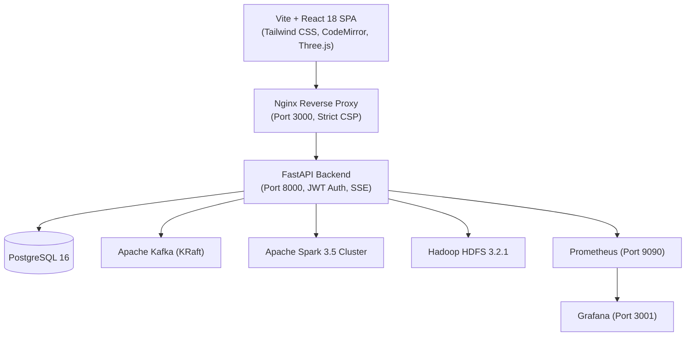
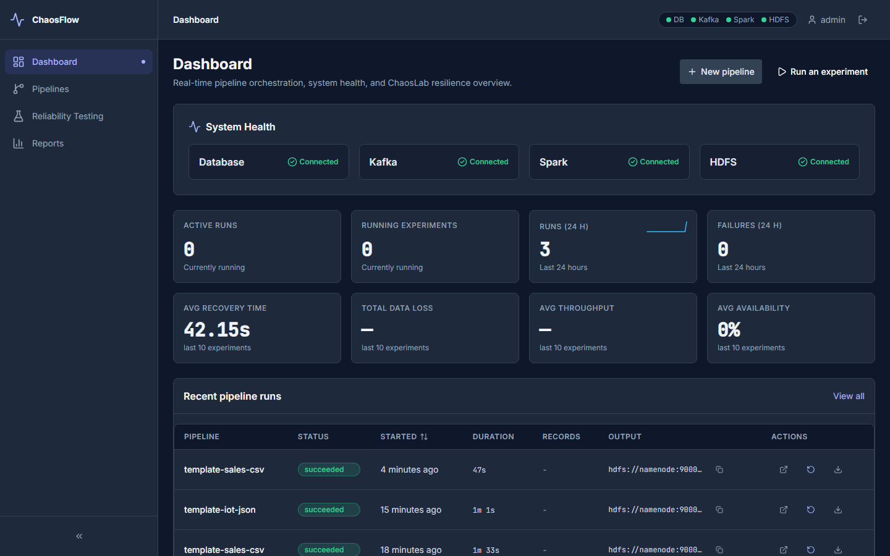
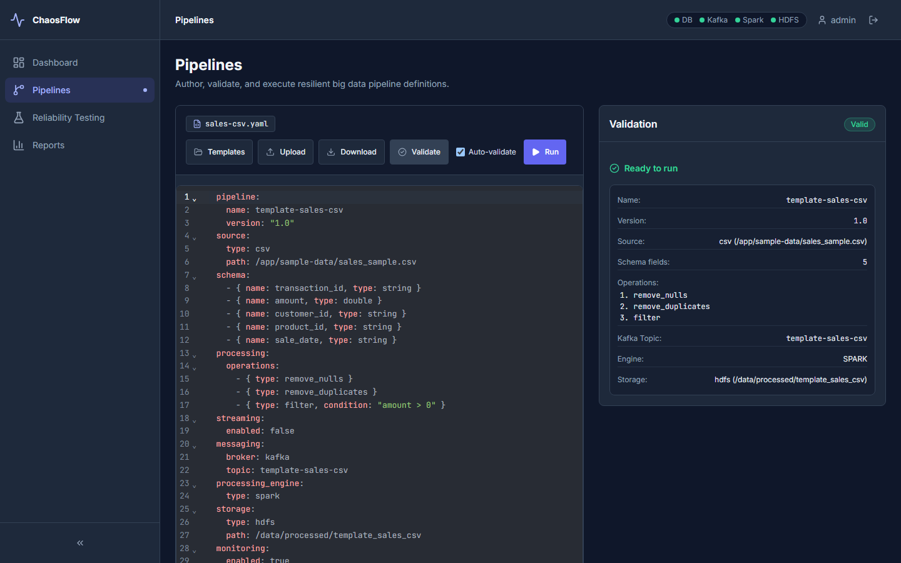
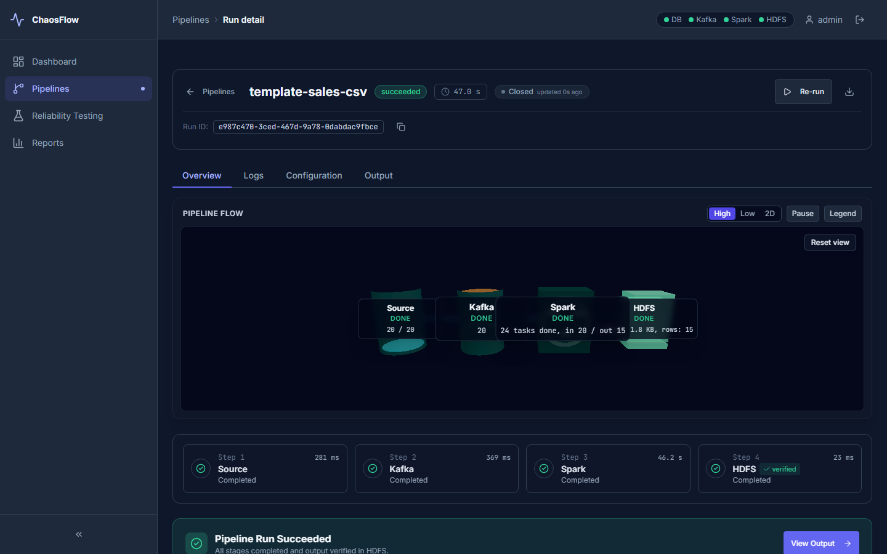
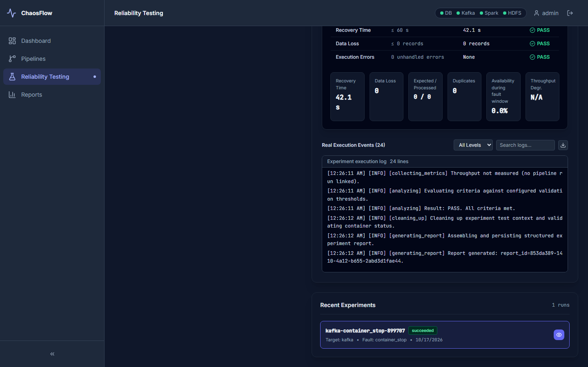
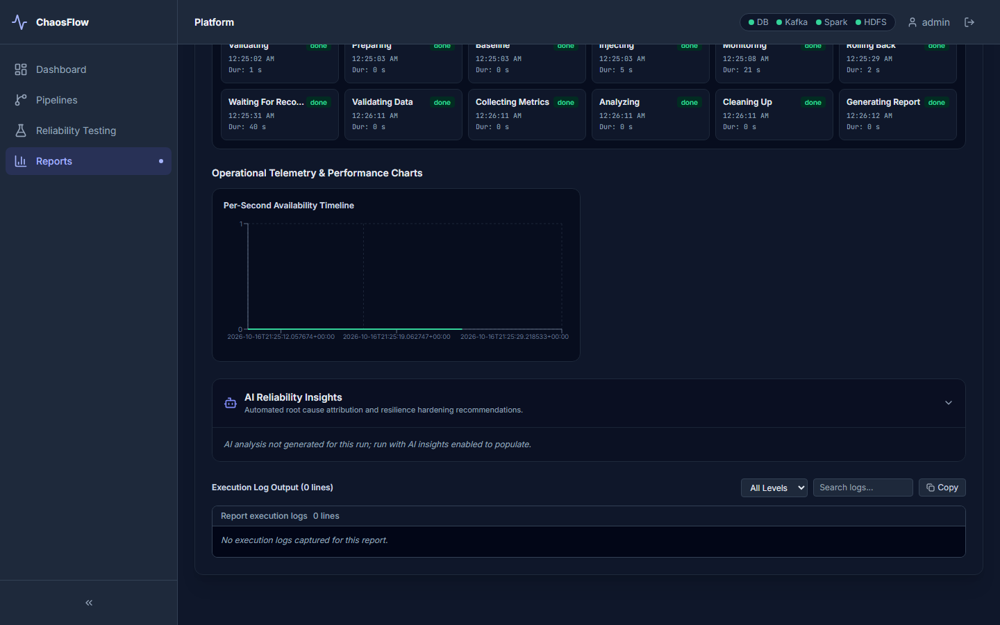

# ChaosFlow: Configuration-Driven Resilient Big Data Pipeline Platform with Built-in Chaos Testing


ChaosFlow is an enterprise-grade platform for authoring, running, observing, and stress-testing big data pipelines under real-world infrastructure failures. It combines declarative YAML pipeline orchestration, interactive cluster topology visualization, and an automated chaos engineering engine (**ChaosLab**) to validate pipeline resilience, calculate recovery times (MTTR), and assess data loss.

---

## Architecture



---

## Quickstart

Get the full 13-container stack running in three commands:

```powershell
# 1. Generate secrets and environment config (.env)
.\scripts\setup-env.ps1

# 2. Build and launch all container services
docker compose up -d --build

# 3. Open the UI in your browser
Start-Process "http://localhost:3000"
```

> **Note on Authentication**: The application presents a login screen on first load. The initial credentials (`ADMIN_USERNAME` and `ADMIN_PASSWORD`) are generated by `setup-env.ps1` and stored securely in `.env`.

---

## Sample Pipelines

ChaosFlow ships with 4 pre-configured declarative pipeline definitions available in the Templates modal:

| Template Name | Source Format | Engine | Destination | Streaming | Key Features |
|---|---|---|---|---|---|
| `sales-csv` | CSV (`sales_sample.csv`) | Spark (Batch) | HDFS Parquet | `false` | Null removal, deduplication, amount filtering |
| `sales-streaming` | CSV / Kafka stream | Spark Structured Streaming | HDFS Parquet | `true` | Micro-batch trigger, consumer lag tracking, watermark |
| `sales-large` | CSV (1M rows) | Spark (Batch) | HDFS Parquet | `false` | Large scale batch processing with fault recovery |
| `iot-json` | JSON (`sensor_readings.json`) | Spark (Batch) | HDFS Parquet | `false` | Semi-structured schema inference and threshold filtering |

---

## Chaos Engineering (ChaosLab)

ChaosLab enables controlled, safety-validated fault injection against live cluster infrastructure:

| Fault Type | Target Service | Blast Radius | Auto-Recovery Mechanism |
|---|---|---|---|
| `container_stop` | `kafka`, `spark-worker`, `datanode` | Single container halted | Automated container start after configured duration |
| `container_restart` | `kafka`, `spark-worker`, `datanode` | Transient outage | Container restarted via Docker daemon API |
| `network_latency` | `kafka`, `spark-worker`, `datanode` | Injected network delay | Traffic control (tc/netem) rules cleared on revert |
| `network_packet_loss`| `kafka`, `spark-worker`, `datanode` | Dropped packet ratio | Traffic control (tc/netem) impairment removed |
| `cpu_burn` | `kafka`, `spark-worker`, `datanode` | CPU core saturation | Stress-ng process terminated on revert |
| `memory_stress` | `kafka`, `spark-worker`, `datanode` | Memory pressure | Stress-ng worker killed and memory reclaimed |

*Safety Validator prevents concurrent experiments, enforces maximum durations, and rejects forbidden targets (`postgres`, `backend`, `frontend`).*

---

## Verification & Tests

### Run the tests

Before running integration tests or test suites requiring the 1M-row dataset, generate the local dataset:
```powershell
# Generate large dataset for integration & streaming tests
python scripts/generate_sales_data.py --rows 1000000
```

1. **Static Analysis & Linting**:
   ```bash
   cd frontend
   npm run lint
   npm run build
   ```

2. **Unit Tests**:
   ```bash
   docker exec platform-backend pytest -q -m "not integration"
   cd frontend && npm run test -- --run
   ```

3. **Backend Integration Tests**:
   ```bash
   docker exec platform-backend pytest -q -m integration
   ```

4. **End-to-End Playwright Tests**:
   ```bash
   cd frontend
   npx playwright test --workers=1 --reporter=line
   ```
   *Note: Playwright tests automatically invoke `global-setup.ts` to generate any missing sample datasets on demand.*

---

## Screenshots Gallery

### Dashboard Overview


### Pipeline Authoring & Validation


### Succeeded Pipeline Run Details


### ChaosLab Reliability Testing


### Automated Resilience Report


---

## Verification Evidence

| Verification Gate | Requirement | Clean-Clone Result | Status |
|---|---|---|---|
| Static Analysis | ESLint & TypeCheck | 0 errors, 0 warnings | **PASS** |
| Frontend Unit Tests | Vitest suite | 24 files, 244 tests passed | **PASS** |
| Production Bundle | Client bundle size | 320.06 kB (< 323.06 kB limit) | **PASS** |
| Backend Unit Tests | Pytest unit suite | 540 passed, 16 skipped | **PASS** |
| Backend Integration | Pytest integration suite | 38 passed | **PASS** |
| Full E2E Playwright | Complete test suite | 58 tests passed in 10 files | **PASS** |
| Automated Demo | 9-Stage Chaos Scenario | Result PASS, MTTR < 60s | **PASS** |
| Checkpoint Hygiene | HDFS `/checkpoints` | 0 leftover directories | **PASS** |

---

## License & Authors

Distributed under the MIT License. Developed for resilient distributed data infrastructure research and engineering.