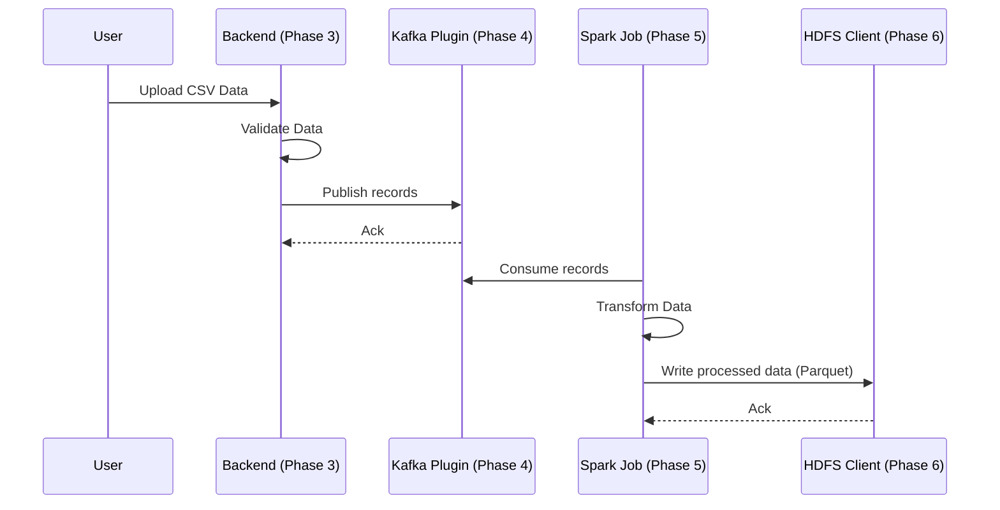
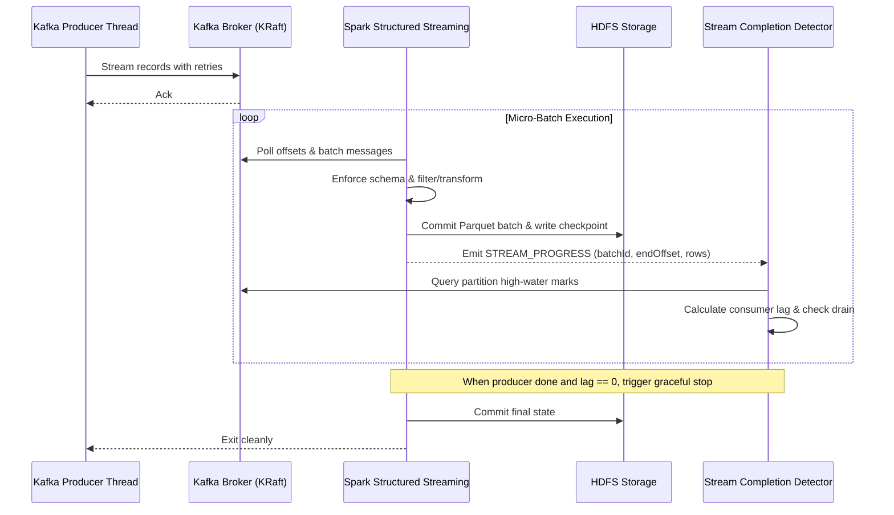

# Data Flow

This sequence covers the primary path of a batch data record through the system.

## Structured Streaming Data Flow

Refer to the respective phase code (e.g., CsvSourcePlugin, Spark jobs, WebHDFS client, stream_progress) for implementation details.
