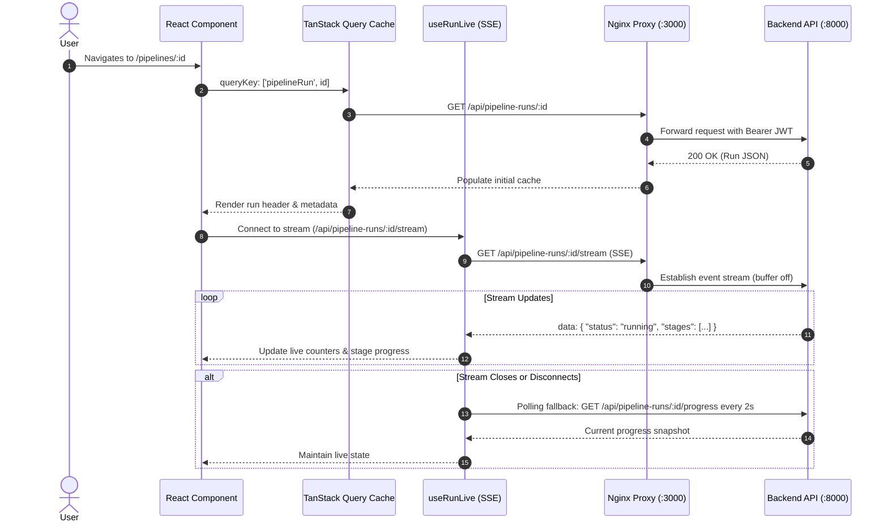

# Frontend Architecture & Developer Guide

## 1. Directory Structure

The frontend is a single-page application built with React 18, TypeScript, Vite, and Tailwind CSS.

```
frontend/
├── e2e/                           # Playwright end-to-end and accessibility test suites
│   ├── bundle.spec.ts             # Lazy-loading and chunk network verification
│   ├── demo.spec.ts               # 16-step full platform demonstration scenario
│   ├── polish.spec.ts             # Global accessibility, axe-core, CSP, rate limit
│   ├── pipelines.spec.ts          # YAML editor, validation, template loading
│   ├── reliability.spec.ts        # ChaosLab experiment wizard and reporting
│   ├── run-details.spec.ts        # Live progress, stage transitions, cancellation
│   └── viz.spec.ts                # Three.js 3D scene rendering and fallback
├── scripts/
│   └── lighthouse-flow.mjs        # Automated Lighthouse user-flow audit script
├── src/
│   ├── api/                       # Typed REST client modules (Axios & fetch)
│   │   ├── client.ts              # Axios interceptors, in-memory auth token handler
│   │   ├── dashboard.ts           # Dashboard summary endpoint client
│   │   ├── experiments.ts         # ChaosLab experiments and reports endpoints
│   │   ├── pipelines.ts           # Pipeline configs, validation, execution endpoints
│   │   └── system.ts              # System health, service status, and login
│   ├── components/                # Reusable UI component library
│   │   ├── dashboard/             # DashboardTrends chart lazy chunk
│   │   ├── experiments/           # Wizard, active monitor, comparison panels
│   │   ├── layout/                # PageLayout, Sidebar, TopBar, RouteAnnouncer, OfflineBanner
│   │   ├── pipelines/             # RunsTable, ValidationErrors, YamlEditor
│   │   ├── reports/               # ReportCard, ReportChart, ReliabilityInsight
│   │   └── ui/                    # Base design system primitives (Card, Button, Dialog)
│   ├── context/                   # React Context providers (AuthContext, SidebarContext)
│   │   └── AuthContext.tsx        # In-memory authentication state and expiry handling
│   ├── features/viz/              # Hardware-accelerated 3D cluster visualizer
│   │   ├── Scene3D.tsx            # Three.js WebGL rendering canvas and node meshes
│   │   ├── PipelineVisualization.tsx # Container, pause/quality controls, text equivalent
│   │   └── use3DScene.ts          # Animation loop, particle transitions, fault highlight
│   ├── hooks/                     # Custom hooks for state and lifecycle
│   │   ├── useAnimatedNumber.ts   # Smooth numeric tweening
│   │   ├── useAuth.ts             # Consumer for AuthContext
│   │   ├── usePolling.ts          # Visibility-aware interval polling
│   │   ├── useRunEvents.ts        # Run event log streaming
│   │   └── useRunLive.ts          # Server-Sent Events with polling fallback
│   ├── lib/                       # Utility functions, formatting, and mappers
│   │   └── format.ts              # Timestamps, durations, byte sizes, number formatting
│   ├── pages/                     # Routed page views
│   │   ├── Dashboard.tsx          # Main cluster status, metrics, and trends
│   │   ├── Login.tsx              # Platform authentication view
│   │   ├── NotFound.tsx           # Accessible 404 error page
│   │   ├── PipelineDetails.tsx    # Live pipeline execution view and tabs
│   │   ├── PipelineManagement.tsx # YAML editor and runs history table
│   │   ├── ReliabilityTesting.tsx # ChaosLab experiment launcher and monitor
│   │   ├── ReportDetails.tsx      # Deep dive into experiment recovery report
│   │   └── Reports.tsx            # Historical reliability reports and comparison
│   ├── styles/                    # Global Tailwind CSS and theme design tokens
│   │   └── index.css              # Custom properties, print styles, reduced-motion rules
│   ├── types/                     # Shared TypeScript domain interfaces
│   ├── App.tsx                    # React Router configuration and route boundaries
│   └── main.tsx                   # React root hydration and QueryClientProvider
├── nginx.conf                     # Nginx proxy configuration, security headers, CSP
├── playwright.config.ts           # Playwright test runner configuration
└── vite.config.ts                 # Vite bundle configuration and manual chunk splitting
```

---

## 2. Data Flow Architecture



### Server-Sent Events (SSE) with Graceful Polling Fallback
Real-time pipeline progression is tracked via `useRunLive(runId)`.
1. Attempts an EventSource connection to `/api/pipeline-runs/:id/stream`.
2. Nginx forwards SSE with `proxy_buffering off` and `proxy_read_timeout 3600s`.
3. If the connection drops or the browser loses connectivity, `useRunLive` immediately switches to a 2-second interval polling fallback against `/api/pipeline-runs/:id/progress` until terminal status (`succeeded`, `failed`, or `cancelled`) is achieved.

---

## 3. Design System & Semantic Tokens

All styling adheres to semantic design tokens declared in `src/styles/index.css`:
- **Surface**: `--surface-base` (`#0f172a`), `--surface-raised` (`#1e293b`), `--surface-border` (`#334155`).
- **Brand**: `--brand` (`#6366f1`), `--brand-hover` (`#a5b4fc`).
- **Stage Colors**:
  - Source: Sky (`#38bdf8`)
  - Kafka: Orange (`#fb923c`)
  - Spark: Purple (`#a855f7`)
  - HDFS: Emerald (`#34d399`)
- **Status Colors**:
  - Success: Emerald (`#34d399`)
  - Warning: Amber (`#fbbf24`)
  - Error: Rose (`#fca5a5`)
  - Neutral / Idle: Slate (`#94a3b8`)

---

## 4. Truthfulness & Data Integrity Rules

1. **No Invented Numbers**: If a metric is not available or not yet measured, it MUST render as an em dash (`—`). Never display `0`, `0.0s`, or `N/A` for unmeasured properties.
2. **Zero `dangerouslySetInnerHTML`**: All dynamic data, error traces, and configuration strings are rendered as text or sanitized syntax nodes to prevent XSS.
3. **In-Memory JWT Tokens**: Access tokens are kept strictly in JavaScript memory (`AuthContext`). They are never persisted to `localStorage` or `sessionStorage`. On page reload, the user re-authenticates to prevent persistent credential hijacking.

---

## 5. Interactive 3D Visualizer Model (`Scene3D.tsx`)

The 3D cluster scene uses Three.js and React Three Fiber:
- **Topology**: Renders 4 primary nodes (Source, Kafka, Spark, HDFS) arranged on a curved conveyor plane with connecting dynamic bezier tubes.
- **Particle System**: When a stage is active, particles travel along the curve from the upstream node to the active node. Particle speed reflects relative throughput.
- **Fault Indication**: When ChaosLab injects a fault into Kafka or Spark, the corresponding 3D node emits an animated red pulse aura.
- **Accessibility Equivalence**: Every 3D visualizer is accompanied by an accessible `<div data-testid="viz-text-equivalent" className="sr-only">` that announces active stages and packet rates to screen readers.

---

## 6. Testing Strategy

1. **Unit & Component Testing (Vitest)**:
   - 24 test suites, 242+ unit tests.
   - Mocked API clients, fast in-memory execution, and accessibility checks with `vitest-axe`.
2. **End-to-End Testing (Playwright)**:
   - Automated testing against the live Docker stack (`http://localhost:3000`).
   - Verifies real authentication, stage transitions, downloads, and responsive layouts.
   - Comprehensive `@axe-core/playwright` accessibility audits at `1440x900` (desktop) and `390x844` (mobile).
3. **Lighthouse User Flows**:
   - Automated multi-step audit (`scripts/lighthouse-flow.mjs`) verifying performance (85+), accessibility (95+), and best practices (95+).

---

## 7. How to Add a New Page or Component

1. Create the page component in `src/pages/MyNewPage.tsx`.
2. Ensure exactly one `<h1>` heading exists on the page.
3. Register the route in `src/App.tsx` inside the `<PageLayout>` children.
4. Add the title mapping in `src/components/layout/RouteAnnouncer.tsx`:
   ```ts
   if (pathname === '/my-route') return 'My New Page';
   ```
5. Wrap data-fetching blocks with `ErrorBoundary` and provide an `ErrorState` fallback.
6. Verify accessibility using `npx playwright test e2e/polish.spec.ts`.
