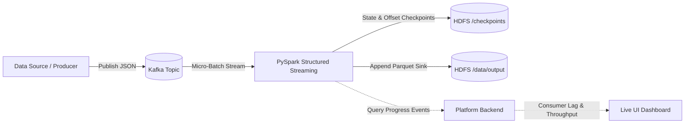

# ChaosFlow Structured Streaming Guide

This guide details how to configure, execute, monitor, and stress-test real-time streaming pipelines using Apache Spark Structured Streaming, Apache Kafka, and Hadoop HDFS within ChaosFlow.

---

## 1. Overview & Architecture

ChaosFlow pipelines support two distinct execution models:
1. **Batch Mode** (`streaming.enabled: false`): Pulls bounded Kafka partition offsets from `startingOffsets` to `endingOffsets` and runs standard batch transformations.
2. **Streaming Mode** (`streaming.enabled: true`): Submits a long-running PySpark Structured Streaming query consuming continuously from Kafka, tracking live consumer lag, checkpointing offsets to HDFS, and terminating gracefully when finite streams drain or on manual cancellation.



---

## 2. YAML Configuration Reference

To activate Structured Streaming, set `streaming.enabled: true` in your pipeline YAML:

```yaml
pipeline:
  name: "sales-streaming"
  version: "1.0"

source:
  type: csv
  path: /app/sample-data/sales_sample.csv

schema:
  - { name: transaction_id, type: string }
  - { name: amount, type: double }
  - { name: customer_id, type: string }
  - { name: product_id, type: string }
  - { name: sale_date, type: string }

processing:
  operations:
    - { type: remove_nulls }
    - { type: filter, condition: "amount > 0" }

streaming:
  enabled: true
  trigger_interval_seconds: 2    # Micro-batch trigger interval (default: 5s)
  idle_timeout_seconds: 10       # Finite drain detection timeout when lag is 0 (default: 20s)
  max_runtime_seconds: 600       # Maximum hard runtime cap before graceful shutdown
  starting_offsets: earliest     # "earliest" or "latest" (default: "earliest")
  watermark:                     # Optional event-time watermarking
    column: sale_date
    delay_seconds: 10

messaging:
  broker: kafka
  topic: sales-stream-events
  partitions: 3
  replication_factor: 1

processing_engine:
  type: spark

storage:
  type: hdfs
  path: /data/processed/sales_streaming

monitoring:
  enabled: true
```

### Key Configuration Directives

| Field | Type | Default | Description |
|-------|------|---------|-------------|
| `streaming.enabled` | boolean | `false` | Enables PySpark Structured Streaming execution mode. |
| `streaming.trigger_interval_seconds` | integer | `5` | Micro-batch processing time trigger interval. |
| `streaming.idle_timeout_seconds` | integer | `20` | Seconds of inactivity after producer completion with zero lag before declaring finite stream drained. |
| `streaming.max_runtime_seconds` | integer | `600` | Hard cap timeout preventing unbounded orphan streaming queries. |
| `streaming.starting_offsets` | string | `"earliest"` | Starting Kafka offset position (`earliest` or `latest`). |
| `streaming.watermark` | object | `null` | Configures event-time column and allowed late data delay. |

---

## 3. Real Consumer Lag Tracking

In streaming mode, the platform computes true Kafka consumer lag:
$$\text{Consumer Lag} = \max\left(0, \sum \text{Topic End Offsets} - \sum \text{Spark Consumed Offsets}\right)$$

- **Kafka End Offsets**: Queried dynamically from Kafka broker partition high-water marks.
- **Spark Consumed Offsets**: Extracted from PySpark `StreamingQueryProgress.sources[0].endOffset`.
- **Live Display**: Shown on the Pipeline Details dashboard via the `Consumer Lag` tile (`data-testid="counter-lag"`) and updated over SSE / polling.
- **Batch Comparison**: In batch mode, consumer lag is strictly reported as `null` (`—`) because batch jobs do not maintain persistent consumer group heartbeats.

---

## 4. Finite Stream Completion Detection

To enable automated testing and finite data ingestion runs without manual intervention, ChaosFlow implements `StreamingCompletionDetector`:
1. **Producer Awareness**: Tracks when the upstream data source finishes publishing all rows (`producer_done=True`).
2. **Zero-Lag Drain**: Once the producer is done, the detector verifies that Kafka consumer lag reaches `0` and all published records have been ingested into Spark (`records_in >= published`).
3. **Idle Timeout**: If no new messages arrive for `idle_timeout_seconds`, the detector signals graceful termination.
4. **Clean HDFS Commit**: Spark Structured Streaming finishes writing the active microbatch, commits the Parquet metadata log to HDFS, removes temporary files, and exits with code 0.

---

## 5. Resilience & ChaosLab Fault Injection

Streaming pipelines are built to survive infrastructure failures without data loss:
- **Broker Restart (`container_restart` on Kafka)**:
  - The producer utilizes a bounded retry queue with exponential backoff (`retries=10`, `retry_backoff_ms=500`).
  - PySpark Structured Streaming automatically reconnects when the broker comes back online.
  - Zero data loss guarantee: $\text{published} = \text{ingested} = \text{output\_rows}$.
- **HDFS Checkpointing**:
  - Offsets and state store files are checkpointed to `hdfs://namenode:9000/checkpoints/streaming-{run_id}`.
  - Exactly-once end-to-end delivery is preserved across task and worker restarts.
